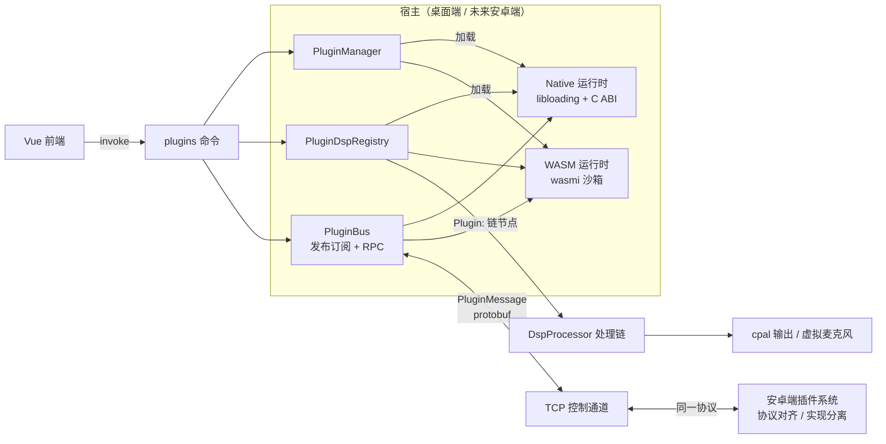
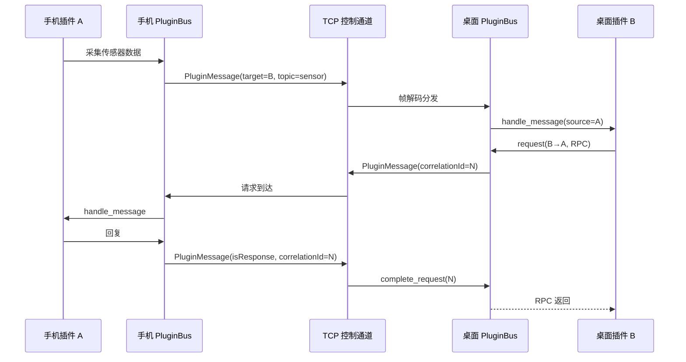

# 插件系统总览

## 目标

- 双运行时：**Native**（cdylib）与 **WASM** 插件，统一抽象、统一清单、统一协议
- 插件可插入 DSP 处理链、注册 UI 面板、订阅事件、跨端收发消息
- 桌面端（Tauri）与未来安卓端共用同一套 Manifest / Host API 能力描述 / 跨端消息协议，仅加载实现不同
- 最小侵入接入现有 `tauri-app` 架构，三个前端（GUI / CLI / TUI）共用同一服务器核心

## 架构图

## 双运行时说明

| 维度 | Native（cdylib） | WASM |
| --- | --- | --- |
| 载体 | `.so` / `.dylib` / `.dll` | `.wasm` 模块 |
| 加载方式 | `libloading` + 版本化 C ABI | `wasmi` 纯 Rust 解释器 |
| 性能 | 最高，可直连系统 API | 解释执行，适合逻辑类 |
| 系统能力 | 全部（驱动、ONNX、音频设备） | 无（内存沙箱 + 宿主授权） |
| 实时安全 | 由插件保证，宿主按 `realtimeSafe` 声明信任 | 默认 best-effort，禁止声明 realtimeSafe |
| 典型用途 | 实时 DSP、虚拟设备、深度集成 | 逻辑扩展、UI 面板、自动化、轻量处理 |
| 跨平台 | 每平台独立构建产物 | 单产物全平台（含未来安卓） |

## 与 DSP 音频链路的关系

- 服务端音频管线运行在专用音频线程（`crates/micyou-core/src/server/audio_pipeline.rs`），PCM 解码后经由 `micyou_audio::DspProcessor::process` 进行链式处理
- 处理链由 `settings.json` 的 `processing_chain` 驱动（默认顺序为 AEC、降噪、去混响、EQ、放大、AGC、VAD；AEC 只是默认排在最前的普通节点，可被拖到任意位置）
- 插件系统通过 `DspProcessor::set_external_hook` 接入音频链，每个启用中的 DSP 插件在链中拥有独立的 **`Plugin:<id>`** 节点；旧版合成节点 `Plugins` 会在原位置展开为逐插件节点
- 声明 `dsp.allowMultipleNodes` 的插件可以用多个 `Plugin:<id>` 节点；宿主通过 `AudioFrameCtx::node_index` / 可选的 `micyou_plugin_process_node` 告诉插件当前是第几个节点
- 插件内部节点执行顺序由 `PluginDspRegistry` 管理（支持 `first` 标记优先，其余按插件 ID 确定性排序）
- 单个插件处理异常时仅记录日志并自动旁路（Bypass），不阻断主音频流水线

## 跨端同步模型

- 消息格式：protobuf `PluginMessage`（`proto/network.proto`），挂载在 `MessageWrapper` 字段 7
- 传输：桌面端通过 TCP 控制通道（`tcp_server`）与手机控制会话
- 语义：发布订阅（topic）+ 请求响应（correlationId）+ 广播（空 target）
- 安卓端复用同一协议与总线语义，仅替换传输实现与插件加载实现

## 插件分类

| 分类 | 说明 | 推荐运行时 |
| --- | --- | --- |
| DSP / Realtime Processor | 实时音频处理节点 | Native（WASM 受限，best-effort） |
| Utility / Service | 后台逻辑、自动化、网络、文件 | WASM / Native |
| UI / Panel | 前端配置面板或可视化组件 | WASM（+ Vue 注册） |
| Bridge / Sync | 跨端状态同步 | Native / WASM |
